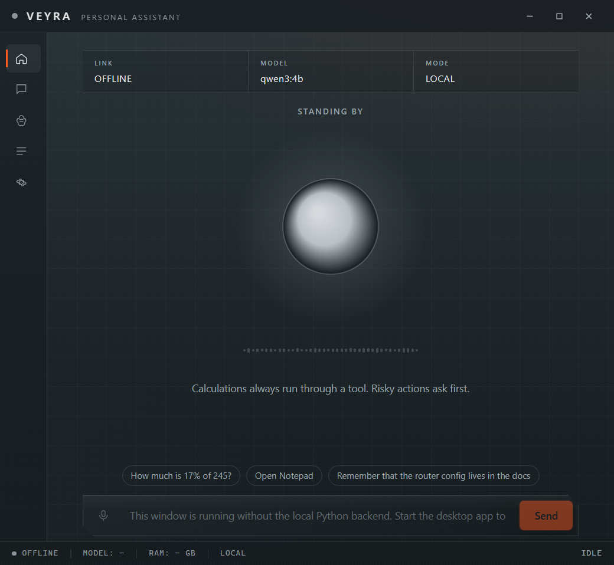
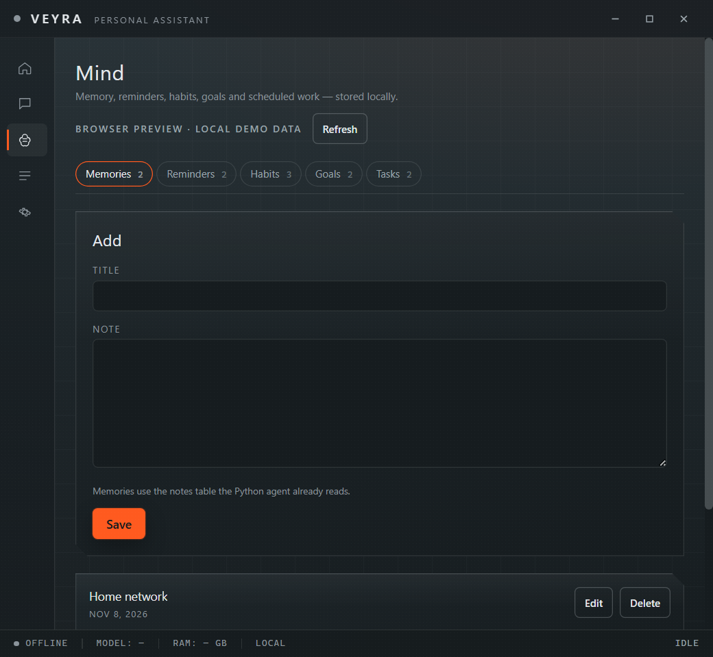

# VEYRA

[](https://github.com/Jaskirat025/VEYRA-Virtual-Enhanced-Yielding-Responsive-Assistant/actions/workflows/ci.yml)

**Virtual Enhanced Yielding Responsive Assistant** — a local-first, proactive AI assistant for Windows.

VEYRA is a desktop application, not a script: a frameless HUD window, a tray icon, an animated core, voice input and speech output, and an agentic tool layer that can actually operate your PC — while keeping as much processing as possible on your machine.

> **Status: 1.0.0 — release candidate, feature-complete.**
> Backend, interface, desktop shell, tool layer, voice pipeline, installer pipeline and CI are in place. The source is feature-complete; the Windows-only shell, audio devices and the NSIS installer still need a real Windows test pass before the 1.0.0 tag (see [installation](docs/installation.md)). Wake-word detection requires a trained openWakeWord model; without one VEYRA stays in push-to-talk mode.

## A first look

<p align="center">
  
</p>
<p align="center"><em>The HUD home screen: live status, the animated core, and one command bar for text or voice.</em></p>

<p align="center">
  
</p>
<p align="center"><em>Mind: memory, reminders, habits, goals and scheduled work in one local workspace.</em></p>

<sub>These are browser-preview captures with demo data. The Windows build starts the local Python sidecar and uses the native Rust Mind core; see [Build from source](#build-from-source).</sub>

---

## One build, three languages

There is **one Windows installer**, not one build per language. Language is a choice, not a fork:

| Where | What you choose |
| --- | --- |
| Installer (NSIS) | **English**, **Italiano** or **简体中文** during setup |
| App interface | English / Italiano / 中文, switchable at any time in **Settings → Language** |
| Spoken answers | VEYRA replies in the language you speak to it |
| Source code, comments, logs, docs | English only |

Everything maintainers read and write stays in English: source, comments, docstrings, log messages, commit messages and documentation. Only user-facing strings are translated, through separate i18n files. The rationale and the implementation plan are in [docs/languages.md](docs/languages.md).

Why not three installers? One binary means one build to test, one signature, one release asset, no duplicated 100 MB downloads, and the user can still switch language later. It is also the lighter option in RAM and maintenance cost.

---

## What VEYRA is meant to do

- **Wake word → listen → transcribe → route → use tools → answer out loud.**
  Default wake word “Ehi Veyra”, changeable in Settings, with a trained openWakeWord model selected in Settings → Audio. Default name “Veyra”, also changeable.
- **Local first.** A quantized 4B model through the bundled Ollama runtime handles everyday requests with no network. Harder work can be escalated to an online model, with automatic fallback to the local one.
- **Proactive mode (optional).** After an idle interval VEYRA can offer one short local check-in and speak timer reminders aloud. Proactive turns never use tools or external services; enable it in Settings.
- **A native memory core.** The Rust shell owns memories, reminders, habits, goals and scheduled tasks in the same `veyra.db` as the Python brain. Notes and timers are shared with the existing agent tools; habits and goals are injected into the agent's system context.
- **Real tools, not chat only.** Open and close applications, control volume and brightness, take screenshots, read and move files, calculate with SymPy, run sandboxed Python, read GitHub issues, and call your own REST APIs.
- **WhatsApp without an unofficial client.** Prepare a message and open the official `wa.me` share page; the user reviews it and presses Send. VEYRA never automates a personal WhatsApp account.
- **Any REST API as a tool.** Define custom endpoints for Exa, Claude, internal services or anything else in Settings. The local model can use them after confirmation; keys stay in Credential Manager and definitions never contain code.
- **Risk-aware execution.** Every tool declares `SAFE`, `CONFIRM` or `DANGEROUS`. Destructive actions always ask first, with a clear summary.
- **A HUD, not a chat box.** A central orb reacts to state (idle, listening, thinking, speaking, error), with real-time waveforms and an always-on-top mini widget that can be enabled in Settings.
- **First-run downloads together.** The portable Ollama runtime is bundled in the installer; the local model, the speech model and the language-matched Piper voice start downloading automatically on first launch, with independent progress and retry. No separate Ollama installation is required.
- **No telemetry, ever.** No connection is made that the user did not explicitly enable.

---

## Design and engineering principles

1. **4 GB RAM budget** on an 8 GB Windows machine. Quantized weights, lazy model loading, unloading idle models, never two LLMs resident at once.
2. **No Electron.** Tauri 2 + WebView2 keeps the shell at a fraction of Chromium's memory.
3. **No local vision models.** Vision is out of scope by design.
4. **One theme, done well.** Dark gunmetal, silver structure, molten orange used only for accents.
5. **Local only by default.** The backend binds to `127.0.0.1` on a random port with a per-run session token.
6. **Secrets never touch the repository.** API keys live in Windows Credential Manager; the repo ships only a fake-value `.env.example`.
7. **The app must never crash because a tool failed.** Errors are data returned to the model and shown in the UI.

---

## Architecture

```
┌──────────────────────────────────────────────┐
│ Tauri 2 shell (Rust, WebView2)               │
│  · frameless window + custom title bar       │
│  · tray icon · close to tray                 │
│  · starts and stops the Python sidecar       │
│  · native Mind core (shared veyra.db)        │
│  ┌────────────────────────────────────────┐  │
│  │ React + TypeScript UI                  │  │
│  │  Home · Chat · Mind · Tool log         │  │
│  │  Settings · Onboarding · Orb           │  │
│  └────────────────────────────────────────┘  │
└───────────────────┬──────────────────────────┘
                    │ WebSocket, 127.0.0.1, random port, per-run token
┌───────────────────▼──────────────────────────┐
│ Python 3.11 backend (FastAPI)                │
│  audio:  openWakeWord → VAD → faster-whisper │
│          → router → agent loop → Piper TTS   │
│  brain:  Ollama client · online client       │
│  tools:  registry, risk levels, pre-filter   │
│  memory: SQLite in %APPDATA%\Veyra           │
│          + Rust assistant core (Tauri)       │
└───────────────────┬──────────────────────────┘
                    │ HTTP, loopback
              ┌─────▼──────┐        ┌────────────────────┐
              │  Ollama    │        │ Online model API   │
              │ local LLM  │        │ user's own key     │
              └────────────┘        └────────────────────┘
```

The Python process is packaged with PyInstaller as a Tauri sidecar: the shell starts it, reads the port and session token from a handshake, and shuts it down on exit.

---

## Requirements

**End users (target):**

| Item | Requirement |
| --- | --- |
| OS | Windows 10 21H2+ or Windows 11, 64-bit |
| RAM | 8 GB total (VEYRA targets ≈ 4 GB) |
| Storage | ≈ 6 GB free (application, bundled runtime and models) |
| Runtime | WebView2 (preinstalled on Windows 11, distributed to Windows 10; the installer verifies it) |
| Local LLM | Portable Ollama runtime bundled; model downloaded on first run |
| Internet | Required for the first-run model download; optional afterwards |
| Microphone | Optional — text input works without one |

**Contributors:** Python 3.11, Node.js 20+, Rust stable with MSVC build tools, Ollama for local development (release builds bundle the portable runtime). See [Build from source](#build-from-source) for the commands.

---

## Build from source

Prerequisites: Windows 10/11, Python 3.11, Node.js 20+, Rust stable with the MSVC build tools, Ollama for local development, WebView2.

```powershell
py -3.11 -m venv .venv
.venv\Scripts\pip install -r backend\requirements-windows.txt
npm --prefix ui install
npm install
npm run dev
```

`npm run dev` starts the React dev server and the Tauri shell, which starts the Python backend on a random loopback port and hands the token to the interface.

To work on the interface alone, against a backend you start yourself:

```bash
python -m backend.main --port 8765 --token dev-token
npm --prefix ui run dev
```

The browser preview has no access to the Windows audio devices, desktop automation or Ollama; the desktop build does.

## Where your data lives

Nothing is written into the installation folder.

| Location | Contents |
| --- | --- |
| `%APPDATA%\Veyra\config.json` | settings (no secrets) |
| `%APPDATA%\Veyra\veyra.db` | SQLite: notes, chat history, timers, habits, goals, scheduled tasks, tool log |
| `%APPDATA%\Veyra\logs\` | rotating local logs, redacted |
| `%APPDATA%\Veyra\models\` | downloaded speech models, never committed |
| `%APPDATA%\Veyra\voices\` | downloaded Piper voices, never committed |
| `%APPDATA%\Veyra\ollama\models\` | downloaded local LLM weights, never committed |
| Windows Credential Manager | API keys, integration tokens, session secrets |

---

## Security and privacy in one screen

- Backend listens on **loopback only**, random port, token authenticated on every HTTP and WebSocket request; token regenerated each start.
- **API keys and integration tokens in Windows Credential Manager** via `keyring`, never in plain text, never logged.
- **Two-step tool risk model** with explicit confirmation dialogs, and a confirmation lockout after reading untrusted external content in the same turn.
- **Prompt-injection aware ingestion**: web and file content is wrapped in `<dati_esterni fonte="...">` blocks marked as data, not instructions.
- **Custom APIs are explicit**: only configured base URLs are reachable, every call is `CONFIRM`, keys are stored separately, and responses are wrapped as external data.
- **Hardened Python sandbox**: separate process, timeout, restricted builtins, an import allowlist and no file, process or network helpers.
- **Privacy controls**: “Delete my data” clears conversations, notes, timers, habits, goals, scheduled tasks, tool logs, settings, downloaded models and stored credentials after an explicit confirmation.
- **Minimal Tauri allowlist** and a restrictive Content Security Policy.
- **No telemetry, no analytics, no auto-update pings.**

Full policy and reporting process: [SECURITY.md](SECURITY.md).

---

## Repository layout

```
veyra/
├── src-tauri/            Rust desktop shell + native Mind core
├── ui/                   React + TypeScript interface
├── backend/              Python brain and audio pipeline
├── docs/                 installation, languages, design system, tools, custom APIs, screenshots
├── scripts/              repository tooling (hygiene gate)
├── .github/workflows/    CI and the Windows installer release pipeline
├── .env.example          fake values only — copy to .env for local dev
├── .gitignore            secrets, databases, models, build output
├── LICENSE               MIT
├── THIRD_PARTY_LICENSES.md
├── CONTRIBUTING.md
├── SECURITY.md
└── CHANGELOG.md
```

Each source directory contains a `README.md` describing its planned layout until the phase that fills it.

---

## Roadmap

| Phase | Scope | Status |
| --- | --- | --- |
| 0 | Repository scaffold, license, policies, docs, CI | done |
| 1 | Backend: local LLM through Ollama + terminal chat | implemented |
| 2 | Tool registry, system and calc tools, agentic loop | implemented |
| 3 | FastAPI + WebSocket + local transport security | implemented |
| 4 | Tauri shell + UI: design system, orb, home, chat | implemented, Windows test pending |
| 5 | Voice output (Piper) with audio-reactive orb | implemented, device test pending |
| 6 | Listening: VAD + faster-whisper + waveform | implemented, device test pending |
| 7 | Wake word with openWakeWord | implemented, model training required |
| 8 | Router with online model and offline fallback | implemented |
| 9 | GitHub tools and custom REST APIs | implemented |
| 10 | Settings, onboarding, tool log, i18n EN/IT/ZH | implemented |
| 11 | Python sandbox and UI automation tools | implemented, Windows test pending |
| 12 | Installer, GitHub Actions release, final documentation | release 1.0.0 prepared, Windows validation pending |
| 13 | Rust Mind core: shared memories, reminders, habits, goals and scheduled tasks | implemented, Windows test pending |

Each phase ends with install commands, a manual test script, Windows troubleshooting notes and a check for personal data and secrets.

---

## Documentation

- [Installation and requirements](docs/installation.md)
- [Releasing: version gate, Windows acceptance, tag and draft](docs/releasing.md)
- [Languages: installer choice, i18n, what stays English](docs/languages.md)
- [Design system: tokens, type, motion, orb states](docs/design-system.md)
- [Adding a tool](docs/adding-a-tool.md)
- [Custom APIs: Exa, Claude and any REST endpoint](docs/custom-apis.md)
- [Proactive mode: local check-ins and spoken timers](docs/proactive-mode.md)

---

## Contributing

Contributions are welcome. Read [CONTRIBUTING.md](CONTRIBUTING.md) first — this project has strict rules about secrets, personal data, licensing and attribution.

## License

MIT, see [LICENSE](LICENSE). Third-party components, models and fonts are listed in [THIRD_PARTY_LICENSES.md](THIRD_PARTY_LICENSES.md).
